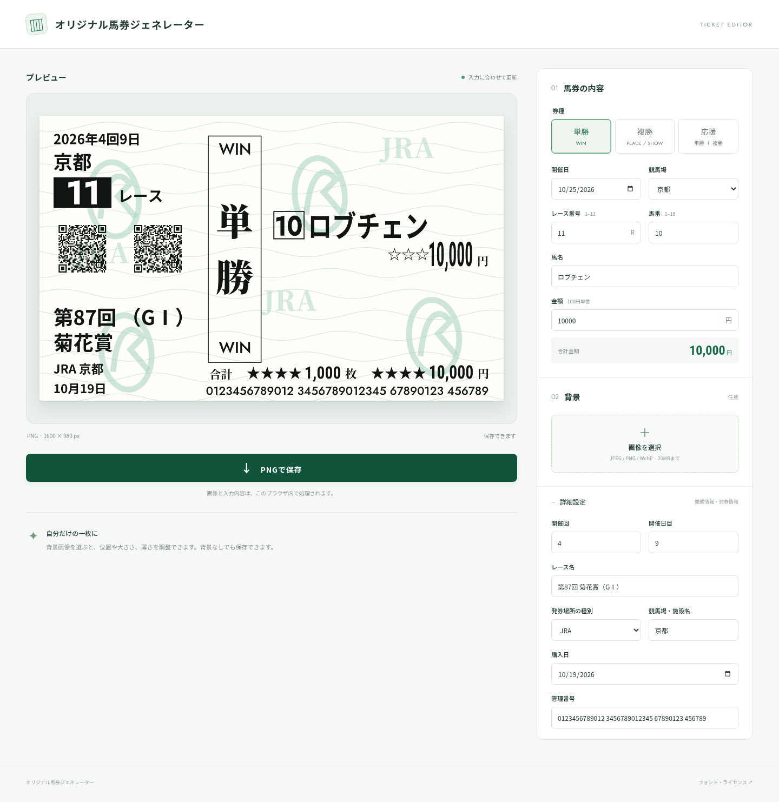

# オリジナル馬券ジェネレーター

単勝・複勝・応援馬券の画像をブラウザ内で作成するPC・スマートフォン向け静的サイトです。入力内容と背景画像は外部へ送信しません。状態の永続化はなく、再読み込みで初期値に戻ります。

## 起動

```sh
python3 -m http.server 8000 --bind 127.0.0.1
```

http://127.0.0.1:8000/ を開きます。Node.jsやビルド作業は不要です。

## GitHub Pages

すべてのアセットを相対URLで参照しているため、プロジェクトサイトのサブパスで配信できます。`.github/workflows/pages.yml` は main へのpushまたは手動実行時にサイトをデプロイします。リポジトリの Settings → Pages → Source を **GitHub Actions** に設定してください。初回はSourceの設定後、Actions → Deploy GitHub Pages → Run workflow を実行してください。Pagesが未有効な間はpush時のデプロイをスキップします。現在はリポジトリが非公開・Pages未有効で、連携からPages設定を変更する権限がないため、実際の公開URLは未確認です。

## 機能

- PCでは2カラム、スマホ・タブレットでは入力フォームをボトムシートで表示
- スマホはシート内でスクロール。馬券をタップするとシートを隠して画面中央に表示し、再タップで編集に戻る
- シートの再表示時は入力とスクロール位置を保持。PNG保存ボタンはシート下部に固定

- 1頭の単勝・複勝、および同額の単複セットである応援馬券
- 左上に年・開催回・開催日目、発券場所はJRAまたはWINSを選択
- 左側はゴシック体（レース番号はJost）、レース名は最初の「回」の直後で改行し、グレードは回数表記の右に表示
- 購入日は開催日とは別に入力し、発券場所の下に月日で表示（初期値は日本時間の当日）
- 券種・各・円・合計・枚はNoto Serif JP（右側ラベル・単位はBold 700）、金額・枚数の数字はRoboto Condensed Bold
- 枚数側と累計額側の黒星は同じサイズ
- 券面の枚数は合計金額÷10で表示
- 即時プレビュー、項目別バリデーション、1600×980px PNG保存
- JPEG・PNG・WebP（20MB以下）の背景、位置・拡大・薄さの調整
- 背景を指定した場合は地模様と透かしを非表示。コードは黒部分のみ描画
- 日本時間の当日を初期日付に採用
- フォントを同梱し、読み込みが完了するまで保存を停止

`app.js` の券面論理座標は800×490、Canvas解像度はその2倍です。プレビューと保存画像で同じCanvasを使用します。地模様・透かし・管理印字は低解像度の参考画像に基づく近似です。2つのQRコードはいずれも `https://kaiseiyokoyama.github.io/baken-generator/` を格納しています。誤り訂正H・4モジュールの透明な余白付きの固定行列を同梱し、外部サービスや実行時の通信なしで黒いモジュールだけを描画します。

## 参考・ライセンス

JRA公式の[単勝](https://www.jra.go.jp/kouza/beginner/baken/img/baken_tansyo.jpg)・[複勝](https://www.jra.go.jp/kouza/beginner/baken/img/baken_fukusyo.jpg)・[応援](https://www.jra.go.jp/kouza/beginner/baken/img/baken_ouen.jpg)画像をレイアウトの参考にしています。参考画像自体はサイトに同梱していません。

Jost、Roboto Condensed、Dela Gothic One、Noto Sans JP、Noto Serif JPを同梱しています。著作権表示とSIL Open Font License全文は `fonts/*-OFL.txt` および `fonts/LICENSES.html` を参照してください。

## 確認用画像

[菊花賞の設定例（PNG）](docs/kikka-win.png) · [単勝](docs/win.png) · [複勝](docs/place.png) · [応援](docs/cheer.png)



ブラウザ検証の結果は [docs/VERIFICATION.md](docs/VERIFICATION.md) を参照してください。

[スマートフォンの編集画面](docs/mobile.png) · [馬券のみの中央表示](docs/mobile-preview.png)
